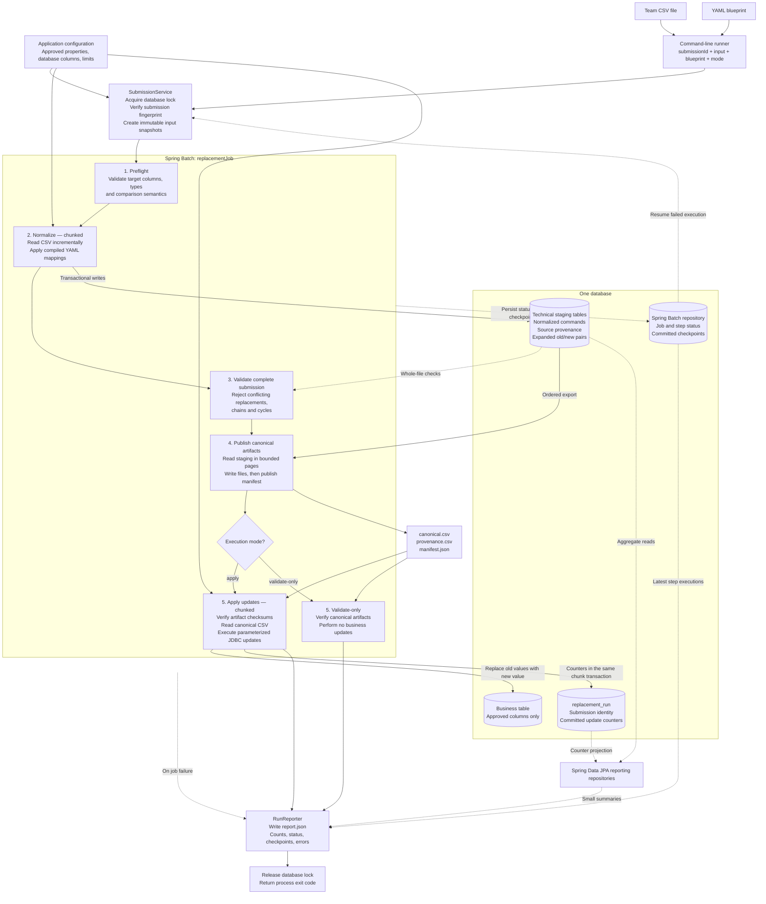
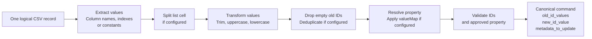

# Dynamic CSV Batch Processor

A **Spring Boot 4.0.8 / Spring Batch 6.0.5 / Java 25** command-line application that accepts a team's CSV and a YAML blueprint, converts the data to one canonical CSV format, validates the entire replacement set, and updates approved properties in one business table.

Teams can keep different CSV layouts. The database update step always reads the same three-column contract:

```csv
old_id_values,new_id_value,metadata_to_update
"[""101"",""102""]","900","customerId"
"[""A1"",""A2""]","B1","departmentId"
```

`metadata_to_update` is a **logical property name**, not a free-form metadata object. The first command replaces **every** matching `customer_id` value `101` or `102` with `900`. It does not select rows by the business table's primary key. There is no tenant/record scope in version 1.

For a first reading, follow [the worked example](#understand-the-solution-through-one-record), then [the architecture](#architecture-and-why-it-is-structured-this-way), and finally [the package and class walkthrough](#packages-and-classes-a-guided-code-walkthrough). The remaining sections are the configuration and operational reference.

## Understand the solution through one record

There are two separate problems: understanding each team's file, and updating the database. **The YAML solves the first problem; a fixed canonical command solves the second.** A new team supplies another blueprint, rather than another Java job.

Consider the first record in `examples/team-a.csv`:

```csv
previous_primary;previous_secondary;replacement;attribute
101;102;900;CUSTOMER
```

The matching blueprint says: collect `previous_primary` and `previous_secondary` as old IDs, read `replacement` as the new ID, and translate the team's label `CUSTOMER` into the application's logical property `customerId`.

### 1. Read the team's syntax

`BlueprintLoader` reads the YAML and checks that the instructions are supported. `BoundedCsv` reads the CSV using the declared semicolon delimiter. It returns a header array and then one data array at a time:

```text
header: [previous_primary, previous_secondary, replacement, attribute]
record: [101,              102,                900,         CUSTOMER]
```

`MappingPlan` resolves the header names to positions once. For this mapping, the old-ID positions are `[0, 1]`, the new-ID position is `2`, and the property position is `3`. It then reuses those selectors for every record. “Compiled” here means preparing Java functions and resolved positions; it does not generate Java code or execute a script.

### 2. Turn a source record into a command

`SourceCommandReader.read()` calls `MappingPlan.apply(...)`. For the record above, the result contains this Java value:

```java
new Command(
    1,                         // first logical data record, excluding the header
    0,                         // first mapping, using a zero-based index
    "replace-selected-property",
    List.of("101", "102"),      // oldIdValues
    "900",                     // newIdValue
    "customerId"               // metadataToUpdate
)
```

The reader returns a `List<Command>` because one source record can have several mappings. Team A has one mapping; `examples/wide.yaml` has two. There is **no separate Spring Batch `ItemProcessor` class** in this implementation: mapping is part of the source reader.

The word “metadata” in the CSV contract means **which property to update**. It does not mean that the command contains a JSON document to merge into a database row.

### 3. Save commands before applying anything

Spring Batch collects a bounded chunk of these lists. `StagingWriter` flattens them and writes two representations:

```text
staged_command: one command, preserving source record and mapping name
  old IDs = ["101", "102"], new ID = "900", property = "customerId"

staged_pair: one row per old ID, for database-wide relationship checks
  customerId: 101 -> 900
  customerId: 102 -> 900
```

These are technical records. The business table has not changed. The staging inserts and the source checkpoint commit together at the end of the chunk.

After all input records have been staged, `GlobalValidator` checks relationships across the entire submission. For example, another row containing `101 -> 800` for `customerId` would conflict with this row. Another containing `900 -> 950` would create a chain. Both cause failure before any business updates.

### 4. Publish the format the update engine understands

Once validation succeeds, `Artifacts` exports staging to `canonical.csv`:

```csv
old_id_values,new_id_value,metadata_to_update
"[""101"",""102""]","900","customerId"
```

The double quoting is CSV escaping around a JSON array. After CSV parsing, the first field is simply `["101","102"]`; after JSON parsing, it is a Java list of two strings. Source record and mapping information go into a separate `provenance.csv`, keeping the canonical file at exactly three columns.

### 5. Apply a fixed command, regardless of its original layout

`CanonicalReader` reads the published file. `ReplacementWriter` looks up `customerId` in trusted application configuration and finds `customer_id`. Through `ReplacementUpdateRepository`, it executes the same prepared update twice, with `(new value, old value)` parameters `("900", "101")` and `("900", "102")`.

The writer no longer needs to know that the original delimiter was a semicolon, that old IDs came from two columns, or that the team used the label `CUSTOMER`. Every matching business row is updated. If two rows contain customer ID `101` and one contains `102`, this command produces **two SQL statements and three affected-row events**.

In `validate-only` mode, the earlier steps still run and produce artifacts, but this step performs no business updates. After the job returns, `RunReporter` reads persisted summaries through JPA repositories and writes `report.json`.

### Terms that are easy to confuse

- **Source record:** one logical data row in the team's CSV. A quoted multiline field still belongs to one record.
- **Command:** one property, one destination, and a list of old IDs. A source record produces one command per YAML mapping.
- **Pair:** one old ID and its destination within a command. Pairs allow indexed global validation without keeping the whole input in memory.
- **Business row:** a row in `business_record`. One pair can match zero, one, or many business rows.
- **Chunk:** the bounded unit committed by Spring Batch. During normalization an item is a source record's `List<Command>`; during apply an item is one `Command`.
- **Submission:** the user's named unit of work, identified by `submissionId` and bound to its inputs/configuration.
- **Job instance:** Spring Batch's identity for that submission. A restart creates another **job execution** for the same instance, with new executions of the steps that need to run.

“One table” means one **business** table. The application also needs technical staging, locking, reporting, and Spring Batch checkpoint tables. They do not represent additional business targets.

## Quick start

Prerequisites: JDK **25**, Maven **3.9+**. Set `JAVA_HOME` to JDK 25 and confirm `mvn -version` reports Java 25. Maven Enforcer rejects other JDK major versions. No preview Java features are needed.

If another Java version is your Windows default, select JDK 25 for the current PowerShell session:

```powershell
$env:JAVA_HOME = 'C:\path\to\jdk-25'
$env:PATH = "$env:JAVA_HOME\bin;$env:PATH"
mvn -version
```

```sh
mvn clean verify
```

Run the included example with an embedded, **file-backed** H2 database and demo data:

```sh
java -jar target/dynamic-csv-batch-processor-0.1.0-SNAPSHOT.jar --spring.profiles.active=demo --input=examples/team-a.csv --blueprint=examples/team-a.yaml --submissionId=demo-validate-001 --mode=validate-only
```

Then apply it using a **new submission ID**:

```sh
java -jar target/dynamic-csv-batch-processor-0.1.0-SNAPSHOT.jar --spring.profiles.active=demo --input=examples/team-a.csv --blueprint=examples/team-a.yaml --submissionId=demo-apply-001 --mode=apply
```

These commands also work in PowerShell. They are intentionally single-line commands to avoid shell-specific continuation syntax. `--mode` defaults to `validate-only` if omitted. Exit code `0` means the job completed; failures return a nonzero exit code.

The demo starts with four business rows: `(101,A1)`, `(102,A2)`, `(101,KEEP)`, `(KEEP,KEEP)`. Applying team A's file changes them to `(900,B1)`, `(900,B1)`, `(900,KEEP)`, `(KEEP,KEEP)`: **five column-update events across three distinct rows**. The report does not label update events as distinct rows.

The `demo` profile seeds once through Flyway. Keep using that profile for that database so Flyway continues to see its demo migration. To repeat from a fresh demo database, choose a new database path, e.g. `--spring.datasource.url=jdbc:h2:file:./data/demo2`, and new submission IDs. The default profile creates an empty example business table; it does not seed business data.

Artifacts appear in `work/<submissionId>/`:

```text
source.csv          immutable input snapshot
blueprint.yaml      immutable blueprint snapshot
canonical.csv       normalized commands (only published after validation)
provenance.csv      canonical record → original data record and mapping
manifest.json       format version, record count, SHA-256 hashes, ready marker
report.json         execution status, counts, checkpoints and errors
```

The database persists under `data/`. Do not remove the database, snapshots, or published artifacts while a run may need to restart. `target/`, `work/`, and `data/` are Git-ignored.

## Architecture and why it is structured this way

The application uses **one Spring Batch job** for every team. YAML describes how to normalize each CSV; the update step only understands the canonical format.



The two mode branches illustrate behavior inside the same `applyUpdates` step, not two separate step definitions. The lock is released in a `finally` block, including if reporting fails.

The diagram distinguishes two repository roles: **Spring Batch's `JobRepository`** persists execution/checkpoint information, while **our Spring Data JPA repositories** read application reporting data. JPA reporting does not load the full staging tables into memory. `SubmissionService` calls the reporter after the synchronous job returns; the diagram's success/failure arrows represent that reporting phase.

There is **one job definition**, `replacementJob`, and five persisted steps:

1. `preflight`: verify the configured table/columns, types, and supported equality semantics.
2. `normalize`: read logical CSV records, execute the compiled blueprint, and transactionally insert canonical commands and expanded old/new pairs into staging tables.
3. `validateCommands`: detect conflicting destinations, replacement chains, and cycles across the entire file using indexed database queries.
4. `publishCanonical`: keyset-page through staging and write canonical/provenance files, then publish their manifest.
5. `applyUpdates`: verify artifact checksums, read **only canonical CSV**, and issue JDBC batch updates. In validate-only mode its reader returns no commands after checking artifacts.

The submission service snapshots and validates the blueprint before launching, holds a global database lock during the synchronous job, and writes the report after the job finishes. Blueprint/header errors are detected when loading/opening the source. Data validation must finish before any business update starts.

### How a YAML mapping processes a record



- **Large files:** records are streamed; only bounded chunks are held in memory.
- **Validation:** the entire submission is checked before business updates begin.
- **Restart:** committed chunks remain saved; failed execution resumes from its checkpoint.
- **Transactions:** each update chunk is atomic. The entire file is not one transaction.
- **Multiple mappings:** one source record can generate several canonical commands.

### Deliberate refinement of the initial design

Normalization stages into the database instead of writing checkpointed CSV and provenance files directly. This makes **source checkpoints, normalized commands, and provenance transactional in one database**. A failed output export is regenerated from staging; there is no partially appended CSV checkpoint to reconcile with a database commit.

The final update engine still consumes the requested canonical CSV. The refinement costs database storage and extra sequential I/O, but simplifies crash recovery and supplies the durable index needed for global validation on large inputs.

Export writes `.tmp` files, closes them, atomically renames them on the same filesystem, and writes `manifest.json` last. If export fails or crashes, rerunning that step regenerates the artifacts. Do not consume a file until its completed manifest exists. This implementation requires a filesystem supporting atomic moves; object-store publication is a future extension. Atomic rename is not a guarantee against storage-device failure or power loss: retain backups and run on durable storage.

Staging assigns an increasing command ID. Export uses an index on `(submission_id, command_id)` and fetches at most 500 commands per query. IDs may contain gaps after a rollback; no logic depends on contiguous IDs. With the single sequential normalization writer, this order preserves source-record and mapping order without OFFSET scans.

## Canonical contract, version 1

- Header order is exactly `old_id_values,new_id_value,metadata_to_update`.
- Encoding is UTF-8, separator is comma, quote is double quote, and a quote inside a field is doubled.
- The writer uses LF record separators and quotes every data field.
- `old_id_values` is a **JSON array of strings inside a CSV field**. CSV escaping and JSON escaping are separate layers.
- `new_id_value` is one string; `metadata_to_update` is an approved logical property.
- Lists must contain at least one ID and no more than `app.max-old-ids`.
- IDs cannot be null, blank, contain NUL, or exceed the property's configured maximum length.
- Leading zeros are preserved: `0012` and `12` are different string IDs.
- Strings are not automatically trimmed or case-folded. Only explicitly configured transformations modify them.
- Original source records and mapping names are kept in `provenance.csv`, preserving the three-column contract.
- Record numbers are one-based **logical data records**, excluding the header and ignored empty records. A quoted field may contain several physical lines.
- The manifest carries version 1, submission ID, command count, canonical checksum and provenance checksum.

An externally modified canonical CSV is rejected by its checksum. The current CLI accepts source CSV + YAML, not arbitrary externally supplied canonical files. A dedicated canonical-import entry point would need full validation and manifest creation.

## YAML blueprint language

The complete example is [examples/team-a.yaml](examples/team-a.yaml):

```yaml
version: 1
name: team-a-id-replacements
input:
  encoding: UTF-8
  delimiter: ";"
  quote: '"'
  escapeMode: doubled-quote
  header: true
  headerMatching: exact
  ignoreEmptyRecords: true
mappings:
  - name: replace-selected-property
    oldIdValues:
      source:
        columns: [previous_primary, previous_secondary]
      transforms: [trim]
      dropEmpty: true
      distinct: true
    newIdValue:
      source:
        column: replacement
      transforms: [trim]
    metadataToUpdate:
      source:
        column: attribute
      valueMap:
        CUSTOMER: customerId
        DEPARTMENT: departmentId
      onUnmapped: error
```

Input:

```csv
previous_primary;previous_secondary;replacement;attribute
101;102;900;CUSTOMER
A1;A2;B1;DEPARTMENT
```

### Supported selectors

Each `source` contains **exactly one** selector:

- `column: replacement`: exact header name, available only with `header: true`.
- `index: 2`: zero-based position, available with or without a header.
- `constant: customerId`: literal string.
- `columns: [old_a, old_b]`: list of named columns, only for `oldIdValues`.
- `indexes: [0, 1]`: list of positions, only for `oldIdValues`.

Quote numeric-looking YAML constants, for example `constant: "0012"`. Scalar coercion is disabled; the loader will not silently turn a YAML integer into an ID string. Missing or duplicate headers, out-of-range indexes, unsupported keys, unknown transforms, and unknown properties fail validation.

### Embedded lists

[examples/split-list.yaml](examples/split-list.yaml) handles:

```csv
old_codes,replacement
101|102,900
```

```yaml
oldIdValues:
  source: {column: old_codes}
  split: {delimiter: "|", mode: literal}
  transforms: [trim]
  dropEmpty: true
  distinct: true
```

This delimiter is independent of the CSV delimiter and is treated literally, not as a regular expression. It supports more than one character. Splitting applies only to one selected cell/constant. The embedded list has no escape language in version 1: if an ID contains the embedded separator, use separate columns. A JSON-array source decoder can be added later.

### Transformations and evaluation order

1. Extract selected values.
2. Split a single list cell if configured.
3. Apply transformations in the listed order, individually to each element.
4. Drop empty strings if `dropEmpty: true`.
5. Remove duplicates, preserving first occurrence, if `distinct: true`.
6. Apply `valueMap` for the property selector, if configured.
7. Validate IDs against the property's configured max length. The logical property is validated at blueprint load time.

Supported transformations: `trim` (Java Unicode-aware `strip`), `uppercase`, and `lowercase` (both use `Locale.ROOT`). `dropEmpty` and `distinct` default to false when omitted and are allowed only on old-value lists. Trimming before dropping empties is explicit. A list empty after filtering is invalid.

`valueMap` applies only to `metadataToUpdate` and requires `onUnmapped: error`. All destinations must be approved logical properties. A property may instead be given as a `constant`. These two forms are exhaustive in version 1: a column-sourced property is rejected at load time. Keeping the property fixed per blueprint lets an unapproved property fail before any row processing.

### Other layouts

- [examples/expected-team-a.csv](examples/expected-team-a.csv): the expected `apply` output for the team-a example after updates.
- [examples/positional.yaml](examples/positional.yaml) uses no header and selects indexes `[0, 1]` and `2`.
- [examples/wide.yaml](examples/wide.yaml) contains two mappings, generating one customer command and one department command from each input row. A file containing one old ID per row generates singleton old-value arrays. It is **not grouped in memory** by destination.

Each mapping emits exactly one command per source record. There are no conditional mappings or optional-row skips yet; every emitted command must be valid. Extra columns are accepted, but a header-bearing file must have the same column count in every record. Positional input must contain every referenced index; unreferenced extra columns are accepted within configured limits.

### Parsing and schema

[schema/blueprint.schema.json](schema/blueprint.schema.json) is an editor-facing JSON Schema using the default mapping-count limit. Associate it with blueprint YAML files in your editor. Runtime validation uses typed Java records and semantic validation, including rules the schema cannot express (header existence, property allowlist, configured limits, and unique mapping names).

The blueprint loader uses SnakeYAML's safe constructor, rejects duplicate keys and collection aliases, limits nesting to 20, and limits YAML to 256 KiB. Unknown fields fail. There is no SpEL, SQL, JavaScript, or arbitrary object construction in the blueprint language.

Input supports a single-character delimiter/quote, doubled quote escaping, configured Java charset, BOM removal, CR/LF/CRLF records, and quoted multiline values. Malformed encoding is rejected rather than replaced with a placeholder. A streaming grammar guard rejects unclosed quotes and characters after a closing quote before allocating oversized records. Backslash escaping, comments, preambles, auto-detected delimiters, and lenient malformed-CSV recovery are not supported.

## Approved properties and business table

Only application-controlled configuration chooses database identifiers:

```yaml
app:
  target-table: business_record
  properties:
    customerId:
      column: customer_id
      max-length: 64
    departmentId:
      column: department_id
      max-length: 32
```

Identifiers must be simple letters/digits/underscores, start with a letter, and be at most 63 characters. Schema-qualified/quoted identifiers are intentionally unsupported; use the connection's schema/search path. Logical properties cannot alias the same physical column. Per-property maximum length is 1..256 Java UTF-16 code units.

Version 1 implements **string IDs only** in case-sensitive variable-length string columns: H2 `VARCHAR` or PostgreSQL `varchar`/`text`. It rejects fixed-width CHAR, numeric columns, H2 `VARCHAR_IGNORECASE`, and PostgreSQL nondeterministic collations. H2 requires its default binary string comparison. Technical staging equality must agree with target-column equality. Numeric/UUID conversion belongs in a future explicit typed registry, with normalized comparison keys; it is not silently inferred.

The writer expands lists into prepared updates grouped by approved property:

```sql
UPDATE business_record SET customer_id = ? WHERE customer_id = ?;
```

Values are always bound parameters. Only trusted registry values produce identifiers. The batch writer uses prepared JDBC updates; reporting uses Spring Data JPA aggregate projections. Database constraints remain authoritative: unique, check, or foreign-key violations fail the current chunk. No-ops (`old == new`) are counted but not sent to the database. Null values in business columns do not match string IDs.

The sample migration creates one business table plus technical tables. For your real table, adapt the initial migration before first deployment or supply a controlled migration strategy for an existing database. Do not edit already-applied migrations. Updating Boot/Batch later may require an explicit Batch repository migration: the bootstrap Java migration is not an automatic schema-upgrade mechanism.

## Replacement semantics: conflicts, chains and duplicates

Sequential replacement is dangerous if `A → B` and `B → C` appear in one submission: original A rows could become C. Therefore version 1 rejects, for the same property:

- One old value with two different destinations.
- Chains where a non-no-op destination is another non-no-op source.
- Cycles and swaps.

Self-mappings are reported as no-ops and excluded from conflict/chain relationships. Identical duplicates are allowed and reported as redundant. They are not globally removed from canonical output; later duplicate statements generally match zero rows. Java and database comparison use the supported exact string semantics.

Validation expands commands into indexed `staged_pair` records. SQL detects relationships across the **entire submission**, including far-apart records, without a file-sized Java map. No business updates occur if a conflict exists. Try `examples/conflict.csv` or `examples/chain.csv` with `examples/split-list.yaml` to observe failure before apply.

If chains/swaps become necessary, add a planning phase that snapshots **target row primary keys, original values, and final values** before any update. Apply that plan by primary key with concurrency checks. Merely putting mappings into a lookup table does not prevent cascades across chunks.

## Large files and bounded memory

The implementation streams with univocity-parsers and an incremental syntax guard. It never reads a CSV into one string/list, splits it by physical line, groups the entire file in memory, or keeps a global set of IDs.

Default limits in `application.yaml`:

- `app.chunk-size=100`: source records during normalization, canonical commands during apply.
- `app.max-columns=128`.
- `app.max-field-chars=8192`, enforced inside the source parser.
- `app.max-record-chars=65536`, enforced on raw CSV characters by the guard and on parsed content.
- `app.max-old-ids=100` per command.
- `app.max-mappings=16` per blueprint.
- `app.max-expanded-pairs-per-chunk=10000`: fails an oversized chunk; lower chunk size to fit.
- `app.statement-timeout-seconds=30` for update statements.
- `app.max-database-attempts=3` for retryable update failures.

Canonical list fields have a separately derived bound because JSON escaping can enlarge them. Each source row is mapped immediately; only bounded command objects are retained in a chunk. Memory scales with configured bounds/chunk size, not total file length. Increasing limits increases worst-case heap requirements. The pair cap is a validation ceiling, not an automatic chunk splitter.

Normalization and apply are single-threaded. This preserves simple ordering/restart semantics and avoids sharing stateful readers between threads. Java 25 virtual threads are not a substitute for bounded JDBC concurrency. Add partitioning only after measuring the actual bottleneck and preserving record boundaries/locking guarantees.

Storage must accommodate the source snapshot, canonical output, provenance, expanded staging rows, their indexes, database transaction logs, and temporary export files. Expansion can be much larger than the source. Hashing, staging, validation, and export require several sequential passes. Allow ample disk space and measure on representative data; a 1 GB input does not imply a 1 GB storage requirement.

Indexes on replaceable business columns are important. One old value may match millions of rows: limiting CSV chunk size **does not bound rows modified or locks held by one SQL statement**. For that workload add primary-key planning/paging. A production throughput or heap guarantee requires measuring the real database and its value distribution.

Generate a file larger than 1 GB without retaining it in memory:

```sh
mvn test-compile
java -cp target/test-classes com.example.csvbatch.tools.GenerateCsv target/large.csv 1100
java -Xmx256m -jar target/dynamic-csv-batch-processor-0.1.0-SNAPSHOT.jar --input=target/large.csv --blueprint=examples/split-list.yaml --submissionId=large-validation-001 --mode=validate-only
```

This generator emits distinct `old_N → new_N` mappings. The command may create tens of millions of technical rows and take substantial time/disk. Use a provisioned PostgreSQL environment for serious qualification. The heap setting is a benchmark configuration, not an assertion that every valid blueprint fits 256 MiB. Record throughput, peak heap, staging/index/WAL sizes, export duration, and restart duration.

## Transactions, retries and restart

The application uses a JDBC `JobRepository`; Spring Batch's resourceless defaults would not provide durable restart. Flyway initializes the correct Batch 6 repository DDL and application tables. `spring.batch.jdbc.initialize-schema=never` avoids a competing schema initializer. Boot auto-configuration is retained; do not add `@EnableBatchProcessing` casually, because it changes infrastructure auto-configuration.

Business updates, database counters, staging writes, and corresponding checkpoints use the same `DataSource` and transaction manager. A failing chunk rolls back. The application is **chunk-atomic, not whole-file-atomic**: previously committed business chunks remain applied after a later failure.

Re-run the same command and submission ID to restart a FAILED or STOPPED execution. Completed steps are skipped; failed normalization/apply resumes from its last committed logical record. Readers reopen the immutable file and parse/discard the committed prefix. This is bounded-memory but O(records already processed); parser-aware checkpoint indexes are a future optimization.

You supply the `--submissionId`; the application does not generate one. It must match `[A-Za-z0-9][A-Za-z0-9_-]{0,79}`, and reusing the same value restarts the run. The application separately binds it to input/YAML SHA-256 hashes, mode, trusted registry/table, work directory, and engine contract version. Changing any of those requires a new submission ID. Files are snapshotted on first submission and checked on restart. Chunk sizing can be lowered when retrying an expansion-limit failure. A new ID creates new work; it is not a restart and can repeat database updates.

If the JVM is forcibly killed, the repository may still say STARTED. Once the old process is confirmed dead, use the same command with `--recover=true`; the service obtains the global database lock and uses Batch 6's recovery API before restarting. Normal failures do not require recovery. Never modify checkpoint tables manually as a routine restart mechanism.

Completed submissions are not executed again. If report publication itself fails after the job completes, business updates remain committed; inspect the repository/technical counters and recover reporting separately rather than choosing a new ID to replay updates.

Transient database exceptions during apply receive bounded retries with exponential backoff (200 ms initial delay, multiplier 2, max 2 s; three total attempts by default). Parsing errors, conflicts, and constraint violations are not skipped. Normalization/validation failures require an explicit restart after correcting the external cause or a new submission for corrected input. No malformed CSV skip policy guesses where the next record starts.

### Concurrency contract

All submissions through `SubmissionService` obtain `SELECT ... FOR UPDATE NOWAIT` on one technical lock row. A dedicated connection holds this lock for the whole synchronous job; chunk transactions use other connections. Concurrent app submissions fail lock acquisition instead of interleaving. The lock is released in `finally` and by the database when the connection dies. Provision at least several connections (default pool size 6).

### Throughput and retention

The application lock serializes all submissions: throughput is one run at a time regardless of pool size or core count. Batch scheduled submissions, or shard by deployment, if that ceiling is too low.

`staged_command`, `staged_pair`, and the per-submission `work/` directory grow without bound; version 1 has no retention policy. Manual cleanup must leave restartable submissions (FAILED, STOPPED) intact, and must delete database staging rows before their work directory.

## PostgreSQL

For local development only, `compose.yaml` starts PostgreSQL 17 with sample credentials:

```sh
docker compose up -d
java -jar target/dynamic-csv-batch-processor-0.1.0-SNAPSHOT.jar --spring.profiles.active=postgres,demo --input=examples/team-a.csv --blueprint=examples/team-a.yaml --submissionId=pg-demo-001 --mode=apply
```

For an existing environment, use the `postgres` profile and environment variables `DB_URL`, `DB_USER`, and `DB_PASSWORD`. Keep credentials out of blueprints and source control. Compose credentials are for local development, not production. H2 file mode is intended for the standalone demo; PostgreSQL is the target for production qualification.

## Reporting and failure policy

`RunReporter` assembles the JSON through three Spring Data JPA repositories: `StagedCommandRepository`, `StagedPairRepository`, and `ReplacementRunRepository`. Its application-data reads contain no SQL or `JdbcTemplate` calls. Spring Batch step information still comes from Spring Batch's `JobRepository`.

The JPA entities are immutable reporting mappings of the existing technical tables. Repository methods return scalar aggregates and small record projections, so staging rows are never collected into Java lists to calculate totals. Simple counts use derived query methods; other aggregates use JPQL/HQL `@Query` methods. The redundant-pair count uses Hibernate's HQL derived-root extension to group and sum in the database. It excludes no-ops and counts extra occurrences within each `(property, old value, new value)` group. This one query depends on Hibernate rather than portable JPQL alone.

`TransactionConfiguration` explicitly keeps `batchTransactionManager` as the primary JDBC manager and marks it with `@BatchTransactionManager` for the Batch repository. The JPA manager is named `transactionManager`, and reporting repositories explicitly select it for read-only transactions. Both use the same database, but JPA reporting happens after batch execution, outside chunk transactions. Adding JPA therefore preserves the shared JDBC transaction boundary for business updates, staging, counters, and Batch checkpoints. Flyway still owns the schema; Hibernate runs with `ddl-auto=validate` and open-in-view disabled.

`report.json` includes:

- Submission/execution IDs, mode, status and execution timestamps.
- Source records committed, staged canonical commands and expanded old-value count.
- No-op and redundant-pair counts.
- Executed SQL statements, known affected-row events, zero matches and unknown driver counts.
- Latest persisted execution/checkpoint information per step.
- Job failure exceptions.
- `notes` (if provided): free-form notes recorded for the run.

Zero matches are permitted and reported. They can mean no original match, a redundant mapping, or data already changed outside the job. JDBC `SUCCESS_NO_INFO` is recorded as an unknown count instead of fabricated success totals. Database counters are transactional and survive restart; step read/write counters describe the latest step execution, not necessarily the whole submission.

Input failures report source record and mapping where available; parser syntax failures carry parser location information. Jobs fail on the first error instead of generating an unbounded in-memory error list. Very early submission errors (for example invalid YAML or an unavailable database) are logged and may have no report. A killed process cannot write its final report; restart supplies the final status.

`validate-only` validates mappings and relationships and publishes canonical artifacts. It does **not** simulate every constraint, count target rows, or promise an exact preview of business changes. It still writes technical staging/repository data. There is no HTTP server or metrics endpoint; operational integration reads `report.json` and the database.

## Tests and verification

```sh
mvn clean verify
```

The standard suite covers blueprint formats and rejection rules, BOM/multiline/escaped values, leading zeros, bounded fields, malformed quotes, parser checkpoint replay, end-to-end normalization/apply, validate-only, global conflicts/chains, changed-input rejection, a late invalid source record, and database failure/restart across committed chunks.

Run the opt-in >1 GiB test with a capped heap:

```sh
mvn "-DlargeFileTest=true" "-DargLine=-Xmx256m" verify
```

This test generates **1,153,437,071 bytes across 143,794 records** with an 8,000-character unused field, then runs snapshotting, streaming normalization, database staging, whole-file validation, export, checksum verification and reporting in validate-only mode. It checks command counts and absence of business writes. This exercises large byte volume; it is not a benchmark of tens of millions of short mappings or high-fan-out updates. It uses a file-backed H2 database with an 8 MiB database cache. Test files remain under `target/` until `mvn clean`; allow several GB of free space.

Local verification after the JPA reporting refactor (2026-09-27, Java 25): the default suite runs 21 tests (4 `AppPropertiesTest`, 5 `BlueprintTest`, 12 `JobIntegrationTest`); `LargeFileTest` is opt-in and 12 more run under `RUN_POSTGRES_TESTS=true`. The >1 GiB `LargeFileTest` runs nightly (and on demand) via CI. These are measured development results, not a production throughput guarantee or a PostgreSQL qualification claim.

An opt-in Testcontainers suite runs the same database contract against PostgreSQL:

```sh
RUN_POSTGRES_TESTS=true mvn verify
```

PowerShell:

```powershell
$env:RUN_POSTGRES_TESTS = 'true'
mvn verify
```

Docker must be running for that suite. CI enables it on a Linux runner with Java 25. Local default tests skip PostgreSQL explicitly; a passing H2 run alone is not proof of PostgreSQL behavior. Production-database performance qualification with representative records and a real process-kill recovery exercise should be run in the deployment environment; H2 tests do not substitute for them.

## Packages (key responsibilities)

- `blueprint`: mapping language load/validation
- `normalization`: CSV reading, checkpointing, staging command generation  
- `execution`: validation, conflict/chain checks, apply/reporting
- `batch`: job wiring and submission lifecycle
- `persistence`: transaction config, JDBC/JPA reporting
- `app`: configuration and entry point

## Not in version 1

Arbitrary scripts/SQL, cross-file joins, grouping/pivot, multiple business tables, tenant scopes, whole-file rollback, chain/swap semantics, distributed workers, automatic CSV dialect guessing. See the roadmap for planned additions.

### Application root: startup and trusted configuration

**[CsvBatchApplication.java](src/main/java/com/example/csvbatch/CsvBatchApplication.java)** is the executable entry point. Its static `main` starts Spring Boot, which creates the configured beans and invokes the application runner. It enables binding of `AppProperties`. After the runner finishes, it obtains Spring's exit code, closes the application context, and exits the process. This is a command-line application, not a controller or web endpoint.

**[AppProperties.java](src/main/java/com/example/csvbatch/AppProperties.java)** binds `app.*` configuration into a Java record. It contains the work directory, launch flag, target table, resource limits, and approved property registry. Its nested `Property` record holds a database column and maximum ID length. Construction validates limits and safe identifier syntax, rejects duplicate physical-column mappings, and copies the property map. `property(key)` resolves a logical name such as `customerId` or throws if it is unapproved. This is the boundary between team-controlled mapping instructions and application-controlled database identifiers.

### `batch`: launching and connecting the steps

**[CommandLineRunner.java](src/main/java/com/example/csvbatch/batch/CommandLineRunner.java)** implements Spring Boot's `ApplicationRunner` and `ExitCodeGenerator` despite its class name. It exists when `app.launch=true`. It validates command-line options, requires `input`, `blueprint`, and `submissionId`, defaults `mode` to `validate-only`, and parses `recover`. It allows Spring/application/logging configuration options alongside its own options. It calls `SubmissionService.submit(...)`, returns success only for a completed job, and logs failures while setting the exit code. It does not parse CSV records itself.

**[SubmissionService.java](src/main/java/com/example/csvbatch/batch/SubmissionService.java)** owns one submission's outer lifecycle. Its `submit(...)` method coordinates these operations:

1. Validate the submission ID, execution mode, and blueprint.
2. Acquire the singleton database lock through `SubmissionRepository` on a dedicated connection and validate the target configuration.
3. Hash the source and blueprint and calculate the submission fingerprint, including the mode, table/property registry, work directory, and engine contract version.
4. Register new work or check that an existing submission has the same fingerprint. Create/check immutable `source.csv` and `blueprint.yaml` snapshots in its work directory.
5. Create job parameters. Only `submissionId` identifies the Spring Batch job instance; the service enforces the additional identity rules itself.
6. If explicitly requested, recover a stale running execution through Batch's recovery API. Start the job synchronously and pass its result to `RunReporter`.
7. Release the lock in `finally`, even if execution or reporting throws.

Its snapshot helper copies through a temporary file, verifies content, and uses an atomic move. A restart uses the saved snapshots rather than accepting a changed input. The service deliberately does not wrap the entire job in one database transaction: the lock connection stays open while separate chunk transactions commit through other connections.

**[JobConfiguration.java](src/main/java/com/example/csvbatch/batch/JobConfiguration.java)** declares `replacementJob` and connects the five steps in order. `preflight`, `validateCommands`, and `publishCanonical` are tasklets: each invokes a specific operation. `normalize` and `applyUpdates` are chunk steps: Spring Batch repeatedly calls their readers and writers and manages commits/checkpoints. The configuration explicitly selects the JDBC batch transaction manager, sets chunk size, and configures bounded retries for transient apply failures.

Its step-scoped reader/writer beans obtain paths, submission ID, and mode from the running job's parameters. Step scope gives each step execution its own reader state. This class is the place to inspect to answer “which class runs next?”; the classes it wires implement the actual work.

**[RunReporter.java](src/main/java/com/example/csvbatch/batch/RunReporter.java)** builds the final report after the job returns, including a failed job. `write(execution, directory)`:

1. Copies submission/execution IDs, status, mode, and timestamps from `JobExecution`.
2. Asks `StagedCommandRepository` for the last committed source record and command count.
3. Asks `StagedPairRepository` for expanded, no-op, and redundant pair counts.
4. Asks `ReplacementRunRepository` for committed SQL/affected-row/zero-match/unknown-count totals. A missing run row is an error, not a fabricated zero result.
5. Asks Spring Batch's `JobRepository` for the latest execution of each named step, including checkpoints and read/write/rollback counts.
6. Adds failure summaries and calls `Artifacts.writeJson(...)` to publish `report.json`.

It contains no application-data SQL and performs no replacements. Application counters cover committed work across restarts; the displayed step counters belong to each step's latest execution. Its repository calls are individual read-only transactions, not one report-wide snapshot transaction. The submission lock remains held during reporting.

### `blueprint`: turn YAML instructions into reusable selectors

**[Blueprint.java](src/main/java/com/example/csvbatch/blueprint/Blueprint.java)** is the typed structure of the YAML language. It stores data; it does not execute mappings. Its nested records mirror the YAML sections:

- `Input`: charset, CSV delimiter/quote/escaping, header behavior, and empty-record handling.
- `Source`: the alternatives `column`, `index`, `constant`, `columns`, and `indexes`; validation requires exactly one.
- `Split`: the optional literal separator for old IDs stored in one cell.
- `Value`: a source plus transformations, list filtering/deduplication, and optional property translation.
- `Mapping`: a name and the three `Value` instructions that produce old IDs, a new ID, and a property.

The enclosing record also carries language version, blueprint name, input settings, and ordered mappings.

**[BlueprintLoader.java](src/main/java/com/example/csvbatch/blueprint/BlueprintLoader.java)** reads a bounded YAML document using SnakeYAML's safe loader, converts it to `Blueprint`, and checks language rules. It rejects unknown keys, duplicate keys, aliases, excessive nesting/size, scalar coercion, unsupported versions, invalid CSV settings, duplicate mapping names, invalid selector combinations, and unsupported transformations. It checks that named selectors require headers and that constant/mapped property names are approved. Explicit input booleans are required, avoiding accidental defaults from omitted YAML fields. Header existence and actual row values are checked later, once the CSV is available.

**[MappingPlan.java](src/main/java/com/example/csvbatch/blueprint/MappingPlan.java)** converts a validated blueprint plus the actual header into executable selectors. Its constructor rejects blank/duplicate header names and resolves names to numeric positions. The private `Compiled` record keeps each mapping's name and three prepared extraction functions. `compile(...)` builds functions that extract, optionally split, transform, filter/deduplicate, and translate values in the documented order.

`apply(row, recordNumber)` executes every compiled mapping and returns a list of `Command` objects. Its shared `validate(...)` checks the logical property, old-list size, and ID content/length; `CanonicalReader` reuses this validation. Errors are annotated with source record and mapping context. Resolving headers once avoids searching header names for every record, while validation still runs for every emitted command.

### `normalization`: stream the source and save normalized work

**[Command.java](src/main/java/com/example/csvbatch/normalization/Command.java)** is the in-memory replacement instruction. It holds the three canonical values plus source record, mapping index, and mapping name. It copies the old-ID list to prevent later mutation. During normalization those extra fields describe original provenance; after canonical reading, the record number refers to the canonical record and the mapping label is `canonical`. Original provenance remains in staging and `provenance.csv`.

**[StrictCsvReader.java](src/main/java/com/example/csvbatch/normalization/StrictCsvReader.java)** is a package-private character-stream guard in front of the CSV parser. Its state machine tracks the start of a field, an unquoted field, a quoted field, and the position after a closing quote. It rejects quotes in unquoted fields, unexpected characters after closing quotes, and an unfinished quoted field at EOF. It counts raw record characters as they arrive and enforces the raw record limit before an oversized record can accumulate. Newlines inside quotes remain part of the same logical record. It checks grammar and size; it does not produce the field arrays.

**[BoundedCsv.java](src/main/java/com/example/csvbatch/normalization/BoundedCsv.java)** configures and owns the univocity parser. It opens a decoder that rejects malformed encoding, removes a leading BOM, wraps the input with `StrictCsvReader`, and applies field/column limits. It preserves field whitespace, treats comments as ordinary input, supports quoted multiline values, and avoids background read-ahead. `next()` returns one `String[]` or `null` at EOF and checks parsed record size. `close()` releases the parser and reader. It knows CSV syntax and resource limits, not replacement semantics.

**[SourceCommandReader.java](src/main/java/com/example/csvbatch/normalization/SourceCommandReader.java)** adapts that parser to Spring Batch as `ItemStreamReader<List<Command>>`:

- `open(context)` opens the snapshot, reads the optional header, creates `MappingPlan`, restores `source.records`, and parses/discards the previously committed prefix on restart.
- `read()` reads one logical record, checks its width against the header when present, and returns `MappingPlan.apply(...)`. It returns `null` at EOF.
- `update(context)` places the current logical record count in `source.records`; Spring Batch persists it at the chunk boundary.
- `close()` closes the CSV resources.

The counter in memory can advance while reading an uncommitted chunk. Only the checkpoint saved by a successful transaction is used by a later restart.

**[StagingWriter.java](src/main/java/com/example/csvbatch/normalization/StagingWriter.java)** receives a `Chunk<List<Command>>`. It flattens the lists, prepares command rows with JSON-encoded old IDs and provenance, and expands each command into one pair row per old ID. It enforces the expanded-pair limit and delegates JDBC batch inserts into `staged_command` and `staged_pair` to `StagingRepository`. Both sets of inserts participate in the step's transaction. It does not write the canonical file or update the business table.

**[CanonicalCodec.java](src/main/java/com/example/csvbatch/normalization/CanonicalCodec.java)** centralizes the canonical format. `HEADER` defines the exact three header names. `json(...)` serializes JSON, `oldValues(...)` accepts only a JSON array of strings, `field(...)` performs CSV quoting, and `row(command)` combines the three fields into one CSV record. Keeping CSV and JSON encoding together prevents the exporter and canonical reader from disagreeing about list representation.

### `execution`: validate the whole submission, publish, and apply

**[TargetValidator.java](src/main/java/com/example/csvbatch/execution/TargetValidator.java)** checks whether the configured database target can implement the promised string-ID semantics. It uses `TargetMetadataRepository` for database inspection, supports H2 and PostgreSQL, inspects approved columns through a query that returns no data rows, verifies variable-length string types and sufficient length, and rejects unsupported comparison/collation behavior. It also checks PostgreSQL staging comparison semantics. The submission service invokes it before launch and the `preflight` step invokes it as part of the job. It validates schema/semantics; it does not count matching business rows or test every possible constraint violation.

**[GlobalValidator.java](src/main/java/com/example/csvbatch/execution/GlobalValidator.java)** checks the indexed `staged_pair` table for the submission through `StagedPairValidationRepository`. One query detects a property/old-ID combination with different destinations. Another detects a destination that is also a source of another replacement for that property, catching chains and cycles. No-ops are excluded from these relationships. It stops with a diagnostic on a detected violation. These database checks replace an unbounded Java map that would otherwise be needed to compare distant records.

**[Artifacts.java](src/main/java/com/example/csvbatch/execution/Artifacts.java)** handles files produced from validated staging:

- `publish(...)` reads commands through `StagedCommandExportRepository` in pages of at most 500, writes canonical and provenance temporary files, renames them, and publishes the manifest last.
- `verify(...)` checks manifest version, readiness, submission identity, and file checksums before consumption.
- `sha256(...)` hashes a file incrementally with a bounded buffer.
- `writeJson(...)` writes JSON through a temporary file and atomic move; reporting reuses it.

File publication is not part of a distributed database/filesystem transaction. If export fails, the step regenerates files from durable staging. The manifest is a completion/integrity marker, not a cryptographic authorization signature.

**[CanonicalReader.java](src/main/java/com/example/csvbatch/execution/CanonicalReader.java)** is `ItemStreamReader<Command>` for the fixed output format. `open(...)` verifies the artifacts, creates the UTF-8/comma parser with bounds large enough for JSON escaping, checks the exact header, and restores `canonical.records`. In apply mode, `read()` checks there are exactly three fields, decodes the old-ID JSON array, revalidates the command, and returns it. In validate-only mode, `read()` returns `null`, so the update writer receives no commands. `update(...)` saves the canonical record checkpoint and `close()` releases resources.

**[ReplacementWriter.java](src/main/java/com/example/csvbatch/execution/ReplacementWriter.java)** receives a chunk of canonical commands. It validates each logical property through `AppProperties`, ignores old/new equality, expands bound `(new, old)` parameters, and groups them by logical property. It enforces the pair cap and delegates database operations to `ReplacementUpdateRepository`. The repository resolves trusted physical columns, uses JDBC `batchUpdate`, interprets update counts, fails on a reported failed statement, distinguishes zero matches from unknown driver counts, and increments `replacement_run` totals in the same transaction. A chunk failure therefore rolls back its business changes and counters together. It does not load business entities or call JPA `saveAll`.

### `persistence`: transaction boundaries and JPA reporting

**[TransactionConfiguration.java](src/main/java/com/example/csvbatch/persistence/TransactionConfiguration.java)** defines two transaction managers over the same data source. `batchTransactionManager` is a `JdbcTransactionManager`, marked primary and `@BatchTransactionManager`, so the batch steps and framework checkpoint repository use JDBC transactions. `transactionManager` is a `JpaTransactionManager` used explicitly by the reporting repositories. This prevents adding JPA from accidentally changing the batch transaction boundary.

JPA is currently used for **reporting reads**. Submission bookkeeping, staging, global validation, export queries, and business updates still use JDBC. This separation is intentional in the current code; moving the report's queries into Spring Data repositories did not convert the entire batch engine to JPA.

#### `persistence.entity`: narrow mappings of existing technical tables

These entities are marked Hibernate `@Immutable` and have protected no-argument constructors for JPA. They map only the columns needed for reports; Flyway owns the full table definitions. They have no relationships that would load associated staging rows, and the repositories expose no save/delete methods. There is no business-table entity in this implementation.

**[StagedCommandEntity.java](src/main/java/com/example/csvbatch/persistence/entity/StagedCommandEntity.java)** maps `staged_command` with JPA entity name `StagedCommand`. It includes `command_id`, `submission_id`, and `source_record`, which are enough to count commands and find committed source progress. The potentially large old-ID JSON payload is intentionally not mapped.

**[StagedPairEntity.java](src/main/java/com/example/csvbatch/persistence/entity/StagedPairEntity.java)** maps `staged_pair` as `StagedPair`. It contains an embedded ID plus property key, old value, and new value. These are the fields needed for total/no-op/duplicate aggregates.

**[StagedPairId.java](src/main/java/com/example/csvbatch/persistence/entity/StagedPairId.java)** is the serializable `@Embeddable` composite key: submission ID, source record, mapping index, and pair index. Its `equals` and `hashCode` use all four fields. Pair position is part of identity so repeated old values can be stored as separate occurrences and reported as duplicates.

**[ReplacementRunEntity.java](src/main/java/com/example/csvbatch/persistence/entity/ReplacementRunEntity.java)** maps `replacement_run` as `ReplacementRun`. It exposes submission identity and the four committed database counters to JPA. Fingerprint, mode, and creation fields used by the JDBC submission lifecycle are not needed in this reporting entity and remain unmapped.

#### `persistence.projection`: small aggregate results

**[StagedCommandSummary.java](src/main/java/com/example/csvbatch/persistence/projection/StagedCommandSummary.java)** is a record with `sourceRecordsCommitted` and `canonicalCommands`. The repository constructs it directly from aggregate results, without creating a Java entity for every staged command.

**[ReplacementRunCounters.java](src/main/java/com/example/csvbatch/persistence/projection/ReplacementRunCounters.java)** is a record with `sqlStatements`, `affectedRows`, `zeroMatches`, and `unknownCounts`. It carries only the data needed by the report's `database` section.

#### `persistence.repository`: validation, export, and reporting queries

**[StagedCommandExportRepository.java](src/main/java/com/example/csvbatch/persistence/repository/StagedCommandExportRepository.java)** owns the JDBC export query and payload mapping. `findExportBatch(...)` uses `command_id > afterCommandId` to return at most 500 rows in ID order. Its `ExportRow` record couples the paging ID with a `Command`.

**[StagedPairValidationRepository.java](src/main/java/com/example/csvbatch/persistence/repository/StagedPairValidationRepository.java)** owns the JDBC conflict and chain/cycle detection queries. Each method returns an optional violation containing a source record and property; `GlobalValidator` applies the rules and formats the errors.

**[ReplacementUpdateRepository.java](src/main/java/com/example/csvbatch/persistence/repository/ReplacementUpdateRepository.java)** owns the parameterized business updates and run-counter updates. Its JDBC template preserves the configured statement timeout and participates in the existing Spring Batch chunk transaction.

**[TargetMetadataRepository.java](src/main/java/com/example/csvbatch/persistence/repository/TargetMetadataRepository.java)** owns database product, column metadata, and H2/PostgreSQL collation reads. It returns metadata to `TargetValidator`, which applies the compatibility rules and formats validation errors.

**[StagingRepository.java](src/main/java/com/example/csvbatch/persistence/repository/StagingRepository.java)** owns batch inserts for staged commands and pairs, participating in the normalization chunk transaction.

**[SubmissionRepository.java](src/main/java/com/example/csvbatch/persistence/repository/SubmissionRepository.java)** stores submission fingerprints and run records. `withExclusiveLock(...)` holds the singleton row lock on a dedicated connection throughout its callback, including job execution and reporting, and releases it on success or failure.

All three reporting interfaces extend Spring Data's narrow `Repository` interface, rather than exposing a general CRUD API. Spring generates the implementations at startup. They explicitly use read-only transactions with the JPA transaction manager. Parameters select one submission; aggregate work happens in the database.

**[StagedCommandRepository.java](src/main/java/com/example/csvbatch/persistence/repository/StagedCommandRepository.java)** declares `summarizeBySubmissionId(...)`. Its JPQL constructor projection returns the maximum committed source record (zero for no commands) and the command count. Maximum record is valid as progress here because every valid source record emits commands and normalization commits sequentially without skipped records.

**[StagedPairRepository.java](src/main/java/com/example/csvbatch/persistence/repository/StagedPairRepository.java)** provides three report operations:

- `countById_SubmissionId(...)`: a derived Spring Data count, following the embedded ID's `submissionId` field.
- `countNoOpsBySubmissionId(...)`: a JPQL count where old and new values are equal.
- `countRedundantBySubmissionId(...)`: a Hibernate HQL aggregate that groups non-no-op pairs by property, old value, and new value, then sums each group's extra occurrences. Three identical occurrences contribute two redundant pairs. The grouped subquery is an HQL extension, not portable JPQL alone.

**[ReplacementRunRepository.java](src/main/java/com/example/csvbatch/persistence/repository/ReplacementRunRepository.java)** declares `findCountersBySubmissionId(...)`. Its JPQL projection returns `Optional<ReplacementRunCounters>`. Absence means the expected run row is missing; an existing run with no applied updates returns a projection containing zero counters.

### `db.migration`: initialize the Spring Batch infrastructure

**[V1__Batch_repository.java](src/main/java/db/migration/V1__Batch_repository.java)** is a Flyway Java migration, outside the application's main package. Flyway discovers it from its configured migration location. It detects H2 or PostgreSQL and executes the matching schema script bundled with Spring Batch using Flyway's migration connection. It initializes the framework's execution/checkpoint tables once. It is not a business-processing step and does not automatically migrate those tables when a later Batch version changes its schema.

### Configuration and resources used by these classes

- **[application.yaml](src/main/resources/application.yaml):** default file-backed H2 connection, connection pool, limits, approved properties, and Flyway/JPA configuration. It disables Boot's automatic job launch because our CLI service must acquire the lock and prepare snapshots first. Hibernate validates the schema rather than creating it.
- **[application-demo.yaml](src/main/resources/application-demo.yaml):** adds the demo Flyway migration location.
- **[application-postgres.yaml](src/main/resources/application-postgres.yaml):** configures the PostgreSQL connection using environment variables.
- **[V2__Replacement_tables.sql](src/main/resources/db/migration/V2__Replacement_tables.sql):** creates the singleton lock row, run identity/counter table, command and pair staging tables with indexes, and the empty sample business table.
- **[V100__Demo_data.sql](src/main/resources/db/demo/V100__Demo_data.sql):** inserts the four demonstration business rows once when using the demo profile.
- **[blueprint.schema.json](schema/blueprint.schema.json):** assists YAML authoring in an editor. `BlueprintLoader` remains the runtime validator.
- **[examples](examples):** input/blueprint pairs that demonstrate named, positional, embedded-list, and multiple-mapping layouts, plus invalid relationship examples.
- **[pom.xml](pom.xml):** selects Java 25, Boot-managed dependencies, packaging, and test/build plugins.
- **[compose.yaml](compose.yaml):** local PostgreSQL development service.
- **[ci.yaml](.github/workflows/ci.yaml):** Java 25 build/test workflow with the opt-in PostgreSQL tests enabled.

### Test classes and the CSV generator

**[BlueprintTest.java](src/test/java/com/example/csvbatch/BlueprintTest.java)** tests the language and parser in isolation: supported mappings, rejected instructions, BOM/quoted multiline input, leading zeros, checkpoint replay, malformed CSV, limits, and string-only JSON old-ID arrays.

**[JobIntegrationTest.java](src/test/java/com/example/csvbatch/JobIntegrationTest.java)** exercises complete submissions against H2. It checks application results/artifacts, validate-only behavior, conflicts/chains, unchanged submission identity, late input failures, normalization/apply rollback and restart, artifact tampering, no-op/duplicate reporting, JPA aggregate isolation, empty results, transaction-manager selection, and `submissionLockExcludesOtherConnectionsAndReleasesAfterFailure`. These tests demonstrate how the collaborating classes behave together.

**[PostgresIntegrationTest.java](src/test/java/com/example/csvbatch/PostgresIntegrationTest.java)** inherits the integration contract and supplies a Testcontainers PostgreSQL database. It runs only when `RUN_POSTGRES_TESTS=true` and requires Docker.

**[LargeFileTest.java](src/test/java/com/example/csvbatch/LargeFileTest.java)** is enabled by `-DlargeFileTest=true`. It generates an input larger than 1 GiB, uses file-backed H2, runs validate-only, and checks command counts and absence of business writes. Its padded records test large byte volume with a manageable number of staging records.

**[GenerateCsv.java](src/test/java/com/example/csvbatch/tools/GenerateCsv.java)** is a standalone development utility with a `main` method, not a JUnit test. It accepts an output path and requested size in MiB and streams distinct replacement rows until reaching that size. It lives under Maven's test source directory so IntelliJ recognizes its package/source root. Compile it with `mvn test-compile` and run it from `target/test-classes`; it is not included in the production executable jar.

### Follow the actual calls in the debugger

For the shortest useful reading order, open `JobConfiguration` first to see the five steps, then follow these call paths:

```text
Startup:
  CsvBatchApplication -> CommandLineRunner.run -> SubmissionService.submit
    -> synchronous job operator -> replacementJob

Normalization, repeated for each source record:
  Spring Batch -> SourceCommandReader.read
    -> BoundedCsv.next -> String[]
    -> MappingPlan.apply -> List<Command>
  Spring Batch collects a chunk -> StagingWriter.write -> technical inserts
  Spring Batch saves the reader checkpoint and commits the transaction

After successful normalization:
  GlobalValidator.validate -> Artifacts.publish

Apply, repeated for each canonical record:
  Spring Batch -> CanonicalReader.read -> Command
  Spring Batch collects a chunk -> ReplacementWriter.write
    -> business updates + replacement_run counters
  Spring Batch saves the reader checkpoint and commits the transaction

After the job returns:
  SubmissionService -> RunReporter.write
    -> Spring Data reporting repositories + Spring Batch JobRepository
    -> Artifacts.writeJson -> report.json
  SubmissionService releases the lock
```

Start with breakpoints in `MappingPlan.apply`, `StagingWriter.write`, and `ReplacementWriter.write` using the small team-A example. These show the three most useful representations: source-derived commands, durable staging rows, and database update parameters. In validate-only mode there is no nonempty apply chunk to inspect.

### A concrete restart example

Suppose the source contains 250 records with one mapping each and chunk size 100. Normalization commits records 1–100 and 101–200. If its next chunk fails, records 201–250 do not become committed staging work and the saved source checkpoint remains 200. On restart with unchanged inputs, the reader parses/discards the first 200 records and resumes from 201. The already committed staging rows are retained. If the cause is invalid input rather than a temporary external failure, correcting the input requires a new submission ID.

If normalization, validation, and publication have completed and an **apply** chunk fails, restarting skips those completed steps. `CanonicalReader` resumes from the committed canonical checkpoint. Prior successful business chunks remain applied; the failed chunk's updates and counters were rolled back together. This is why a checkpoint, a database transaction, and immutable input snapshots are all needed.

### Where to change the application later

- **A new team's supported CSV layout:** add a blueprint; no Java class changes are needed.
- **Another approved column in the same business table:** update the trusted registry and database migration/schema as appropriate. Existing submission fingerprints prevent silently changing the meaning of an in-progress run.
- **A new selector or transformation:** extend `Blueprint` if the syntax needs new fields, `BlueprintLoader`, `MappingPlan`, the editor schema, examples, and focused tests.
- **A new global relationship rule:** extend `GlobalValidator` and its integration tests.
- **A new report metric:** add an aggregate repository method/projection and assemble it in `RunReporter`; avoid fetching all staged entities.
- **Different update semantics, such as chains or scoped rows:** change the execution/planning design and its tests; a YAML-only change cannot safely add those behaviors.

### Source layout at a glance

```text
src/main/java/com/example/csvbatch/
  AppProperties.java                 trusted registry and resource limits
  blueprint/Blueprint.java           typed language model
  blueprint/BlueprintLoader.java     safe loading and semantic validation
  blueprint/MappingPlan.java         compiled selectors and transformations
  normalization/BoundedCsv.java       bounded parser configuration
  normalization/StrictCsvReader.java  streaming syntax/record guard
  normalization/SourceCommandReader.java  restartable source reader
  normalization/StagingWriter.java   transactional normalization/provenance
  normalization/CanonicalCodec.java  CSV/JSON serialization
  execution/GlobalValidator.java     indexed global relationship checks
  execution/TargetValidator.java     schema/type/equality validation
  execution/Artifacts.java           canonical/provenance/manifest publication
  execution/CanonicalReader.java     checksum-verified restartable reader
  execution/ReplacementWriter.java   bounded replacement grouping and delegation
  batch/JobConfiguration.java        one job with five persisted steps
  batch/SubmissionService.java       identity, snapshots, lock, launch/recover
  batch/CommandLineRunner.java       CLI options and process exit status
  batch/RunReporter.java             durable run report
  persistence/TransactionConfiguration.java  explicit JDBC batch and JPA reporting managers
  persistence/entity/               immutable technical-table reporting mappings
  persistence/projection/           aggregate result records
  persistence/repository/           JDBC validation/export and Spring Data JPA reporting queries
src/main/java/db/migration/           Batch repository bootstrap migration
src/main/resources/db/               technical/business/demo migrations
schema/                             editor schema
examples/                           supported layouts and rejection examples
src/test/java/com/example/csvbatch/tools/GenerateCsv.java
                                    bounded-memory large-file generator
```

## Extension roadmap

1. Add explicitly typed numeric/UUID properties and equivalent database comparison keys.
2. Add JSON-array list decoding and simple deterministic conditional mappings.
3. Add an audited primary-key replacement plan for chains, swaps, constrained row scope, and large fan-out.
4. Add parser-aware checkpoints or immutable file segments for faster large-file restart.
5. Add artifact retention, staging cleanup, object-store publishing, and report-regeneration commands. Cleanup must account for pending restarts; no automatic deletion is implemented.
6. Add representative PostgreSQL load benchmarks, fault injection, and operational metrics exporters.
7. Add partitioning only with explicit property/row isolation and transactional correctness tests.
8. Add authenticated submission APIs or scheduling around the existing service if needed; keep the canonical update engine unchanged.

Version 1 intentionally omits arbitrary scripts/SQL, cross-file joins, grouping/pivot operations, multiple business tables, tenant scopes, whole-file rollback, chain/swap semantics, distributed workers, and automatic CSV dialect guessing. The goal is a small mapping language that can evolve without a new batch implementation per team.

## Reference documentation

- [Spring Boot 4 system requirements](https://docs.spring.io/spring-boot/4.0/system-requirements.html)
- [Spring Boot Batch auto-configuration](https://docs.spring.io/spring-boot/4.0/reference/io/spring-batch.html)
- [Spring Batch 6 migration guide](https://github.com/spring-projects/spring-batch/wiki/Spring-Batch-6.0-Migration-Guide)
- [Spring Batch chunk configuration and transaction boundaries](https://docs.spring.io/spring-batch/reference/step/chunk-oriented-processing/configuring.html)
- [Spring Data JPA repository transactions](https://docs.spring.io/spring-data/jpa/reference/jpa/transactions.html)
- [Hibernate HQL, including derived roots for grouped aggregates](https://docs.jboss.org/hibernate/orm/7.0/querylanguage/html_single/Hibernate_Query_Language.html)
- [univocity-parsers source and documentation](https://github.com/uniVocity/univocity-parsers)

Batch 6 infrastructure APIs live under `org.springframework.batch.infrastructure.*`, and core job/step classes have their current package layout. Dependencies are managed by Boot's BOM; the application uses the Batch 6 chunk builder with an explicit database transaction manager.

## License

Licensed under the [Apache License, Version 2.0](LICENSE).
